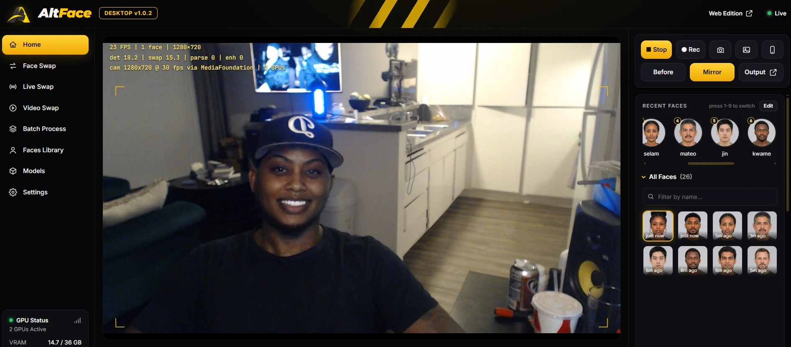
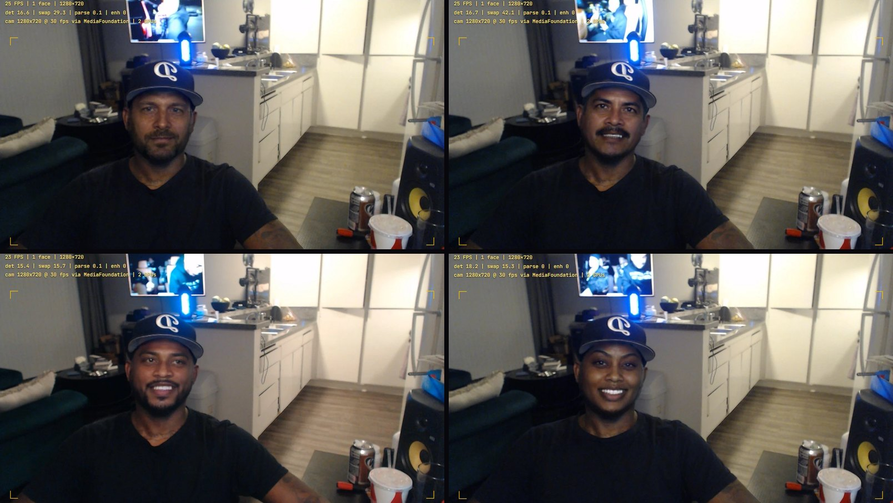
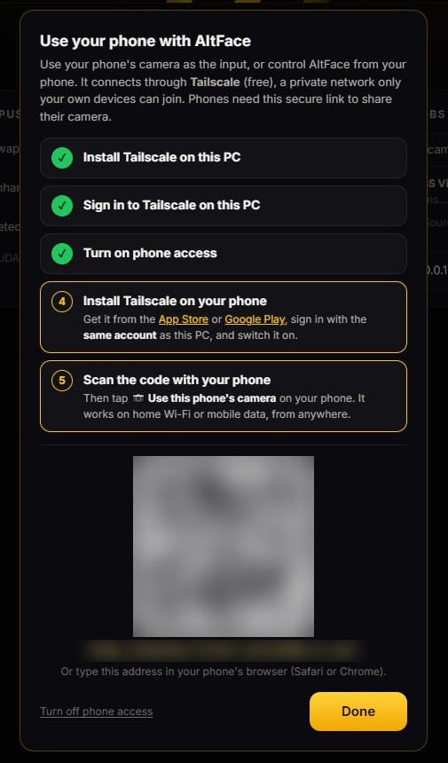
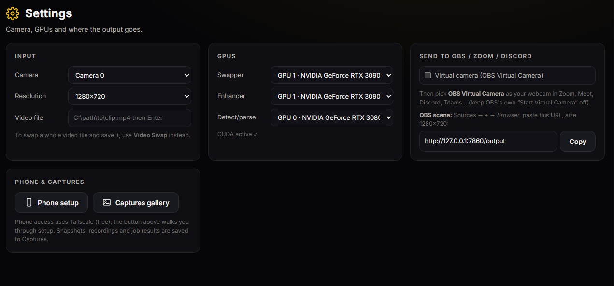

  

<h3 align="center">AltFace Desktop: live face swap on your own NVIDIA GPU</h3>

  <a href="https://github.com/agent9ether/altface-desktop/releases/latest"><b>⬇ Download the latest version</b></a>
  &nbsp;·&nbsp;
  <a href="https://altface.app">Try the web edition</a>

https://github.com/user-attachments/assets/bd4c91e7-13ce-4c51-aaa3-506d18013b20

<b>70-second demo:</b> live swap, faces library, virtual camera, phone camera and more.

  

---

This repository hosts the **Windows installers and release notes** for AltFace Desktop.
Everything runs locally on your PC. Your camera, photos and faces never leave it.

## Features

- **Live Face Swap** on your webcam (or your phone's camera, see below), with a preview window and a virtual camera for OBS, Zoom, Discord and similar apps
- **Full head mode** (optional): swaps the whole head, hair included
- **Video Swap** and **Batch Process** for photos and video files
- **Background changer**: blur, solid color or your own image
- **Faces library** with starter faces, plus per-face saved settings
- Uses **two GPUs** when you have them; optional **NVIDIA TensorRT** for extra speed

## Screenshots

**One webcam, four faces.** Each swap runs live at 23–25 fps on the GPU, picked from the built-in starter faces
(AI-generated people, not real ones):

<table>
  <tr>
    <td width="38%" valign="top"> 
      <b>Phone setup:</b> use your phone's camera, step by step.</td>
    <td valign="top"> 
      <b>Settings:</b> pick the camera, which GPU does what, and send the output to OBS, Zoom or Discord.</td>
  </tr>
</table>

## Requirements

| | |
|---|---|
| OS | Windows 10 (1809 or newer) or Windows 11, 64-bit |
| GPU | NVIDIA GeForce RTX (or GTX 16-series and newer) with an up-to-date driver |
| Disk | About 5 GB (app plus models), more for the optional downloads |
| Internet | Only for the first launch, to download the face models (about 1.8 GB) |

AMD and Intel graphics, macOS and Linux aren't supported by the desktop app.
For those, use the [web edition](https://altface.app) in Chrome or Edge.

## Install

1. Download `AltFace-Desktop-Setup-<version>.exe` from the [latest release](https://github.com/agent9ether/altface-desktop/releases/latest).
2. Run it. The installer isn't code-signed yet, so Windows may show **"Windows protected your PC"**.
   Click **More info → Run anyway**.
3. Optionally tick **Full head mode** (540 MB) and **NVIDIA TensorRT** (1.9 GB).
   You can also get both later from the app's **Models** page.
4. On first launch the app downloads the face models, then opens in your browser.

To update, run the newer installer over the old one. Your faces, captures and settings are kept.

## Use your phone as the camera

Your phone's camera can be the input, with the swap running on your PC. You can also control the app from your phone.
It connects through [Tailscale](https://tailscale.com) (free), a private network that only your own devices can join,
so it works on home Wi-Fi or mobile data. Phones only share their camera over a secure (https) link, which is why a
plain Wi-Fi address isn't enough.

Click the **phone icon** in AltFace Desktop. The setup guide checks off each step:

1. Install [Tailscale for Windows](https://tailscale.com/download/windows) on your PC and sign in.
2. Click **Turn on phone access** in the guide. If Tailscale asks you to approve it once, the guide shows the link.
3. Install Tailscale on your phone ([iPhone](https://apps.apple.com/app/tailscale/id1470499037) /
   [Android](https://play.google.com/store/apps/details?id=com.tailscale.ipn)) and sign in with the **same account**.
4. Scan the QR code, or type the `https://….ts.net` address shown into Safari or Chrome.
5. Tap **📷 Use this phone's camera**.

Only devices signed in to your Tailscale account can open it. You can turn it off from the same guide.

## Responsible use

Use only **your own face**, or faces of people who have **given you permission**.
Don't use AltFace to impersonate anyone, deceive people, commit fraud, or create sexual or
harassing content of real people. Doing so may be illegal where you live.

## Licences

- AltFace Desktop is free to use for **personal, non-commercial** purposes. The app itself is
  closed source; this repository only distributes the installer.
- The face swap model (InsightFace InSwapper) is licensed for **non-commercial research use only**.
  It is downloaded on first launch, not bundled in the installer.
- NVIDIA CUDA, cuDNN and TensorRT components are subject to NVIDIA's licence terms.

## Problems?

Open an [issue](https://github.com/agent9ether/altface-desktop/issues) with your Windows version,
your GPU model and what happened. A screenshot helps.
