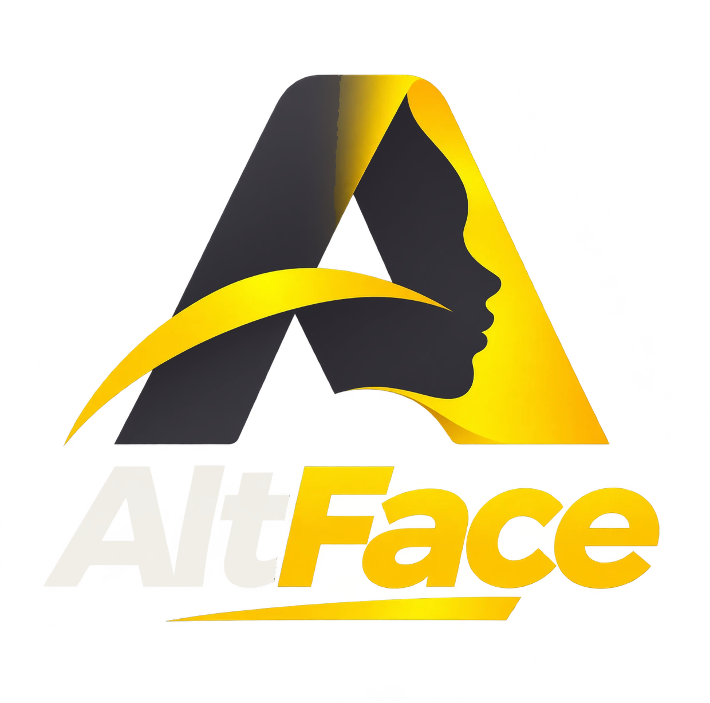

  

<h3 align="center">AltFace Desktop: live face swap on your own NVIDIA GPU</h3>

  <a href="https://github.com/agent9ether/altface-desktop/releases/latest"><b>⬇ Download the latest version</b></a>
  &nbsp;·&nbsp;
  <a href="https://altface.lovable.app">Try the web edition</a>

---

This repository hosts the **Windows installers and release notes** for AltFace Desktop.
Everything runs locally on your PC. Your camera, photos and faces never leave it.

## Features

- **Live Face Swap** on your webcam (or your phone's camera over Wi-Fi), with a preview window and a virtual camera for OBS, Zoom, Discord and similar apps
- **Full head mode** (optional): swaps the whole head, hair included
- **Video Swap** and **Batch Process** for photos and video files
- **Background changer**: blur, solid color or your own image
- **Faces library** with starter faces, plus per-face saved settings
- Uses **two GPUs** when you have them; optional **NVIDIA TensorRT** for extra speed

## Requirements

| | |
|---|---|
| OS | Windows 10 (1809 or newer) or Windows 11, 64-bit |
| GPU | NVIDIA GeForce RTX (or GTX 16-series and newer) with an up-to-date driver |
| Disk | About 5 GB (app plus models), more for the optional downloads |
| Internet | Only for the first launch, to download the face models (about 1.8 GB) |

AMD and Intel graphics, macOS and Linux aren't supported by the desktop app.
For those, use the [web edition](https://altface.lovable.app) in Chrome or Edge.

## Install

1. Download `AltFace-Desktop-Setup-<version>.exe` from the [latest release](https://github.com/agent9ether/altface-desktop/releases/latest).
2. Run it. The installer isn't code-signed yet, so Windows may show **"Windows protected your PC"**.
   Click **More info → Run anyway**.
3. Optionally tick **Full head mode** (540 MB) and **NVIDIA TensorRT** (1.9 GB).
   You can also get both later from the app's **Models** page.
4. On first launch the app downloads the face models, then opens in your browser.

To update, run the newer installer over the old one. Your faces, captures and settings are kept.

## Responsible use

Use only **your own face**, or faces of people who have **given you permission**.
Don't use AltFace to impersonate anyone, deceive people, commit fraud, or create sexual or
harassing content of real people. Doing so may be illegal where you live.

## Licences

- AltFace Desktop is free to use for **personal, non-commercial** purposes. The app itself is
  closed source; this repository only distributes the installer.
- The face swap model (InsightFace InSwapper) is licensed for **non-commercial research use only**.
  It is downloaded on first launch, not bundled in the installer.
- NVIDIA CUDA, cuDNN and TensorRT components are subject to NVIDIA's licence terms.

## Problems?

Open an [issue](https://github.com/agent9ether/altface-desktop/issues) with your Windows version,
your GPU model and what happened. A screenshot helps.
